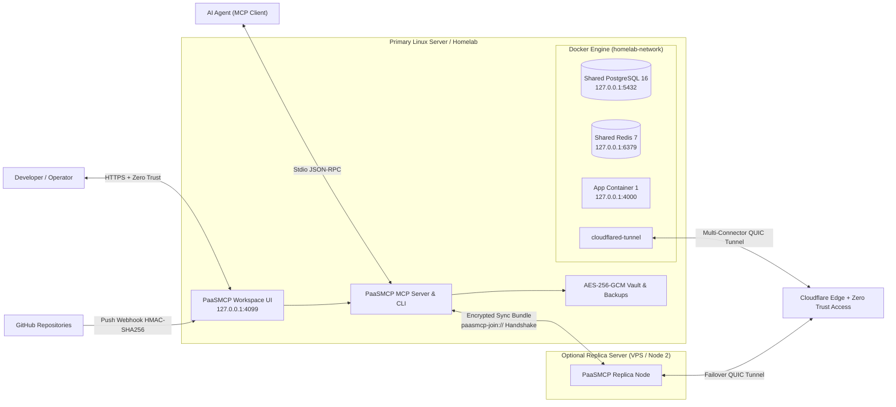

# 🚀 PaaSMCP — Agent-First Micro-PaaS & MCP Server

[](./LICENSE)
[](https://nodejs.org)
[](https://modelcontextprotocol.io)

> **Turn any Linux server or Homelab into a modern automated Cloud PaaS operated directly by AI Agents via MCP (Model Context Protocol) or Humans via a sleek Web Control Plane — with zero idle RAM overhead.**  
> 🇧🇷 **[Leia a Documentação Completa em Português aqui (docs/PT-BR.md)](./docs/PT-BR.md)**

---

## 💡 Why PaaSMCP?

Traditional self-hosted PaaS dashboards are great for manual clicking, but they:
1. Consume **300MB–1GB+ of RAM** continuously just to run their control plane daemons and internal queues.
2. Require manual multi-step setup for SSH deploy keys, database bindings, and Cloudflare Tunnel / Zero Trust rules.
3. Were **not designed from day one to be operated by AI Agents via MCP**.

**PaaSMCP** takes a radically lightweight, **Agent-First & Security-First** approach:
- **0 MB Idle Daemon Overhead:** Runs on-demand via MCP stdio or CLI, orchestrating native Docker Compose stacks directly on your host. (The optional web dashboard and GitHub webhook receiver are a small always-on service.)
- **Human-in-the-loop for risky actions:** Agents run safe actions freely; destroying, purging, restoring, deleting secrets, public exposure, trusted apps and federation changes wait for a person to approve them in the dashboard or with `paasmcp approve <id>`. Destroyed apps go to a 30-day trash. See [Security model](#-security-model).
- **AES-256-GCM Encrypted Secrets & Backups Vault:** Secrets (`/opt/homelab/paasmcp/vault/<app>.enc.json`) and database snapshots (`/opt/homelab/paasmcp/backups/<id>.enc.bak`) are encrypted at rest with a `0600` master key. Values are masked in MCP outputs (`sk_l****def`) and can be ingested directly from files so sensitive keys never pass through LLM chat histories.
- **Instant Multi-Tenant Databases + Encrypted Snapshots:** Provision isolated PostgreSQL 16 databases (`db_<app>` + `user_<app>`) or Redis 7 logical instances in 1 second, automatically injecting `DATABASE_URL` and `REDIS_URL`, with 1-click encrypted `pg_dump` backup & zero-plaintext-disk restore.
- **Zero-Config Buildpacks + Multi-Service Docker Compose Pass-Through:** Automatically builds repositories with a custom `Dockerfile`, sanitized multi-service `docker-compose.yml` (stripping unsafe `privileged`/`host` flags and injecting Vault secrets), or generates optimized multi-stage Dockerfiles for **Node.js, Next.js, Vite/React/Astro SPAs, Python (FastAPI/Flask/Django), Go, and Static HTML**.
- **1-Second Image Rollback & `paas_doctor` Diagnostics:** Automatically tags the previous working image (`paasmcp/<app>:previous`) before every deploy for instant 1-second rollback, and inspects containers for `OOMKilled`, crash-loops, and live CPU/RAM metrics (`docker stats`).
- **Multi-Server Handshake & Federation (in progress):** Pair a secondary server using a signed `paasmcp-join://` token (`HMAC-SHA256` + SSH fingerprint) and sync configuration and vault. Data (databases, files) is **not replicated yet**, so active-active is only safe for stateless apps; the database/file mirror is on the [roadmap](./CONTRIBUTING.md).
- **Built-in Workspace Web UI (`paasmcp-dashboard`):** Optional ultra-lightweight dark/light web workspace (protected by constant-time `DASHBOARD_TOKEN`, login rate-limiting, CSP headers, and Cloudflare Zero Trust Access) with built-in **GitHub Push Webhook (`X-Hub-Signature-256`)** auto-deploy receiver.

---

## 🏗️ Architecture



---

## ⚡ Quick Installation

### Requirements
- Linux (Ubuntu/Debian/Fedora/Arch)
- Docker Engine & Docker Compose plugin (`docker compose`)
- Node.js `>= 20.0.0` & `git`

### 1-Command Setup
```bash
git clone <repository-url>
cd paasmcp
./scripts/install.sh
```

---

## 🛡️ Security Model

| Level | Actions |
| :--- | :--- |
| Free | status, logs, doctor, deploy, provision DBs, create backups, restart, rollback, expose via Tailscale or Zero Trust |
| Confirm | destroy (to 30-day trash), restore a backup (a safety backup is taken first), delete a secret (old value archived), public exposure, exposing the dashboard, federation join/import |
| Strong (type the name) | purge from trash, mark an app as trusted (keeps privileged / host network / host folders / docker.sock in its compose), publish the dashboard on the open internet (only with 2FA on) |
| Forbidden | plaintext secrets in outputs, dashboard on the open internet without 2FA, MCP over HTTP outside loopback/Tailscale, non-loopback ports, compose `extends` / `additional_contexts`, unsigned webhooks |

MCP tokens have levels: `read` (status, logs, diagnostics), `deploy` (default: also deploy, provision, back up, expose privately) and `destroy` (can *request* risky actions, which still need a person). Local stdio runs with full level because it already runs on the server.

MCP calls that need confirmation return `confirmationRequired` with an `approvalId`. A person approves it in the dashboard (Pending confirmations) or with `paasmcp approve <id>` on the server, then the agent repeats the call with `approvalId`. Requests expire in 10 minutes, are bound to the exact parameters and work once. Everything is logged to `audit.log`.

Limit: this protects against an agent acting **through MCP**. An agent with a shell on the server and access to Docker can bypass any rule (the `docker` group is root-equivalent); run such agents as a user without Docker access.

---

## 🔌 MCP Server Configuration (16 Tools)

### Remote clients (MCP over HTTP)

Any MCP client that supports Streamable HTTP with a bearer header (Claude Desktop/Code, Cursor, VS Code, Codex, local-model clients…) can connect from another machine on your Tailnet:

```bash
paasmcp token create laptop --level deploy        # shown once; only a hash is stored
paasmcp mcp serve --port 4098                      # listens on 127.0.0.1 (or --host tailscale)
tailscale serve --bg --https=8443 http://127.0.0.1:4098
```

```json
{
  "mcpServers": {
    "paasmcp": {
      "type": "http",
      "url": "https://<your-server>.ts.net:8443/mcp",
      "headers": { "Authorization": "Bearer pmcp_..." }
    }
  }
}
```

Web-only assistants (ChatGPT / Claude.ai connectors) need a public URL with an OAuth login; that is planned, and a bearer token alone on the open internet is refused on purpose. Run `paasmcp mcp serve` as a systemd service to keep it up (this is the one always-on part of remote MCP).

### Two-factor login for the dashboard

```bash
paasmcp dashboard 2fa enable     # scan the otpauth link, type the first code to activate
```

With 2FA on, login needs token + code, the token alone (header or cookie) stops working, and the dashboard may be published on the open internet after a strong confirmation.

### Local client (stdio)

Add `paasmcp` to your MCP client configuration:

```json
{
  "mcpServers": {
    "paasmcp": {
      "command": "node",
      "args": ["/path/to/paasmcp/dist/mcp-server.js"]
    }
  }
}
```

### Available MCP Tools

| Tool | Description |
| :--- | :--- |
| `paas_approvals` | Lists confirmation requests and their status. Agents can read them but never approve. |
| `paas_system_status` | Returns server hardware stats (CPU/RAM/Disk), live per-container CPU/RAM (`docker stats`), SSH deploy key, masked tokens, DBs, backups, and federation state. |
| `paas_bootstrap` | Initializes `/opt/homelab/paasmcp`, master encryption key, SSH deploy key, Docker network, and shared Postgres/Redis. |
| `paas_dashboard` | Starts the Web Workspace UI (`127.0.0.1:4099`) + GitHub Webhook receiver and optionally exposes it (`zero-trust`, `public`, or `tailscale`). |
| `paas_configure` | Configures Cloudflare `accountId`, `tunnelId`, `baseDomain`, `zeroTrustEmails`, and `tailscaleDomain`. |
| `paas_github_key` | Retrieves the SSH Ed25519 public deploy key + SHA256 fingerprint or auto-registers it on a GitHub repository via API. |
| `paas_secret_set` | Encrypts and stores secrets in AES-256-GCM Vault (from key-values, `.env`, or secret file path). |
| `paas_secret_list` | Lists secret keys for an app or `system` with masked values (`sk_l****def`). |
| `paas_secret_delete` | Deletes a secret key from the encrypted vault. |
| `paas_db_provision` | Creates an isolated PostgreSQL or Redis database and binds `DATABASE_URL` / `REDIS_URL` into the app's vault. |
| `paas_storage_provision` | Gives an app its own S3 bucket and key on this server (Garage, started on first use) and injects `S3_*` / `AWS_*` into its vault. |
| `paas_db_backup` | Creates, lists, restores and **tests** AES-256-GCM encrypted `pg_dump` / Redis / Docker volume snapshots (SHA-256 checked); `sync` sends them off-site (S3/R2/B2/Garage), `fetch` brings one back. |
| `paas_app_deploy` | Clones/updates a GitHub repo or local folder, builds Dockerfile or sanitized `docker-compose.yml`, sets CPU/RAM limits, tags `:previous` image, and starts containers. |
| `paas_app_expose` | Exposes an app via Cloudflare Tunnel (`public` or `zero-trust` OTP gate) or `tailscale`. |
| `paas_app_lifecycle` | Reads container `logs`, or runs `restart`, `stop`, `start`, `rollback` (1-second revert to `:previous`), `destroy` (to the 30-day trash), `restore` (from the trash) or `purge`. |
| `paas_doctor` | Diagnoses `OOMKilled` events, crash-loops, non-zero exit codes, and recent error logs across all containers. |
| `paas_node_federation` | Generates signed `paasmcp-join://` tokens, pairs secondary servers, and exports/imports encrypted Vault & State sync bundles. |

---

## 💻 CLI Reference

```bash
# Initialize PaaSMCP and start shared Postgres, Redis & Web Workspace
paasmcp init --postgres --redis --dashboard

# Configure Cloudflare Tunnel & Domain settings
paasmcp config --account-id <CF_ACCOUNT_ID> --tunnel-id <CF_TUNNEL_ID> --domain example.com --zero-trust-emails you@example.com

# Store platform tokens in the encrypted 'system' vault
paasmcp secret set system CF_API_TOKEN=your_cf_token GITHUB_TOKEN=your_gh_token

# Deploy an app from GitHub with PostgreSQL and 512MB RAM limit
paasmcp deploy my-saas owner/my-private-saas --branch main --postgres --memory 512m --cpus 1.0

# Create an encrypted database snapshot & restore if needed
paasmcp db-backup create my-saas postgres
paasmcp db-backup list
paasmcp db-backup restore <backup-id>
paasmcp db-backup create my-saas volume      # every Docker volume of the app
paasmcp backup test <backup-id>              # restores into a temporary DB; live data untouched

# S3 bucket + key for an app on this server (Garage); redeploy to load S3_* / AWS_*
paasmcp storage provision my-saas

# Off-site copies (R2, B2, S3, Garage): set BACKUP_S3_ENDPOINT, BACKUP_S3_BUCKET,
# BACKUP_S3_ACCESS_KEY_ID, BACKUP_S3_SECRET_ACCESS_KEY (+ optional BACKUP_S3_REGION, BACKUP_S3_PREFIX)
# in the "system" vault scope, then:
sudo paasmcp backup install-timer --hour 3   # daily: DB + volume backups, upload, prune local copies older than 7 days (only if already off-site)
paasmcp backup export-key                    # store the master key OUTSIDE the server; off-site backups are useless without it
paasmcp backup fetch <backup-id>             # on a fresh server: bring a backup back, then restore it

# Run health diagnostics or 1-second rollback
paasmcp doctor
paasmcp rollback my-saas

# Approve what an AI agent asked for (people only)
paasmcp approvals
paasmcp approve c-7F3K2A

# Remote MCP clients and dashboard 2FA
paasmcp token create laptop --level deploy
paasmcp mcp serve --host tailscale
paasmcp dashboard 2fa enable

# Trash: destroy is reversible for 30 days
paasmcp destroy my-saas
paasmcp restore my-saas
paasmcp trash purge-expired   # run daily from cron

# Pair a secondary server (config & vault sync; data mirror in progress)
paasmcp node invite https://paas.example.com --mode active-active-tunnel
paasmcp node join paasmcp-join://...
```

---

## 📚 Additional Documentation

- 🇧🇷 **[Guia Completo em Português (`docs/PT-BR.md`)](./docs/PT-BR.md)**
- 🏛️ **[Technical Architecture, Security Model & Roadmap Specs (`docs/ARCHITECTURE.md`)](./docs/ARCHITECTURE.md)**
- 🤝 **[Contributing & Detailed Roadmap for Developers / LLMs (`CONTRIBUTING.md`)](./CONTRIBUTING.md)**
- 🤖 **[AI Agent Development Rules (`AGENTS.md`)](./AGENTS.md)**

---

## 📄 License

Released under the [MIT License](./LICENSE).
