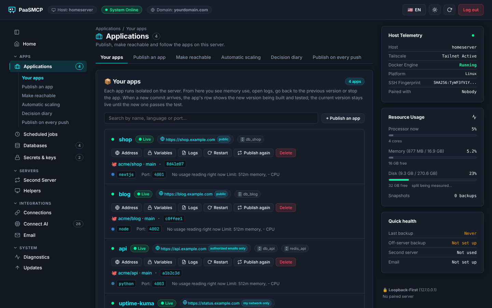
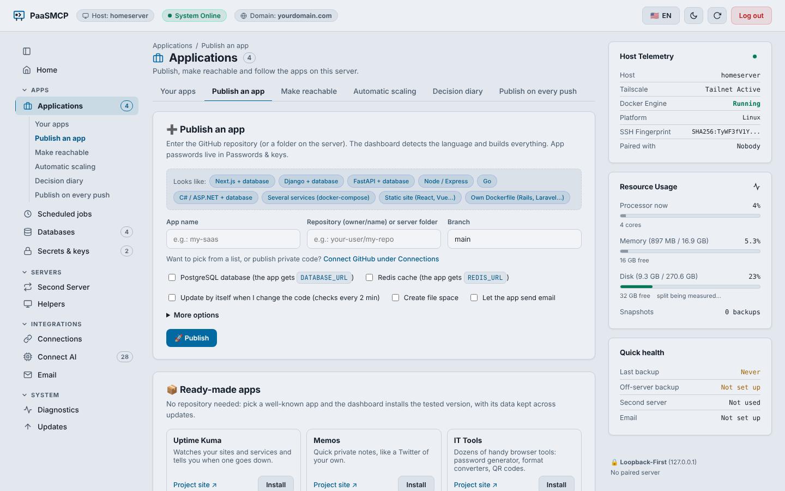
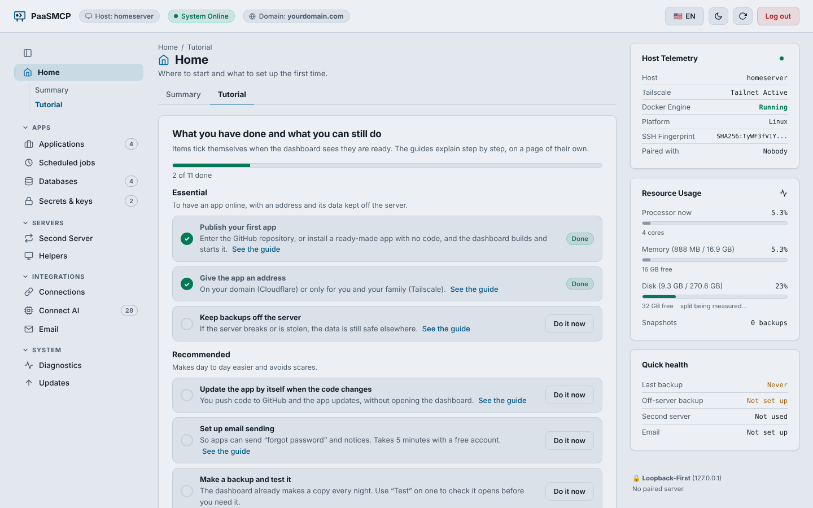
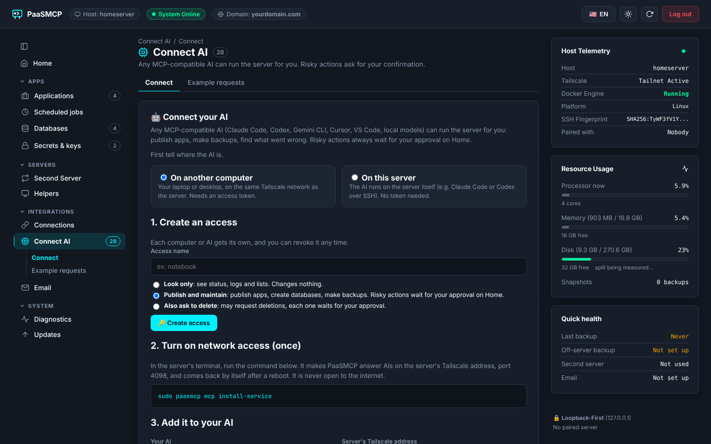
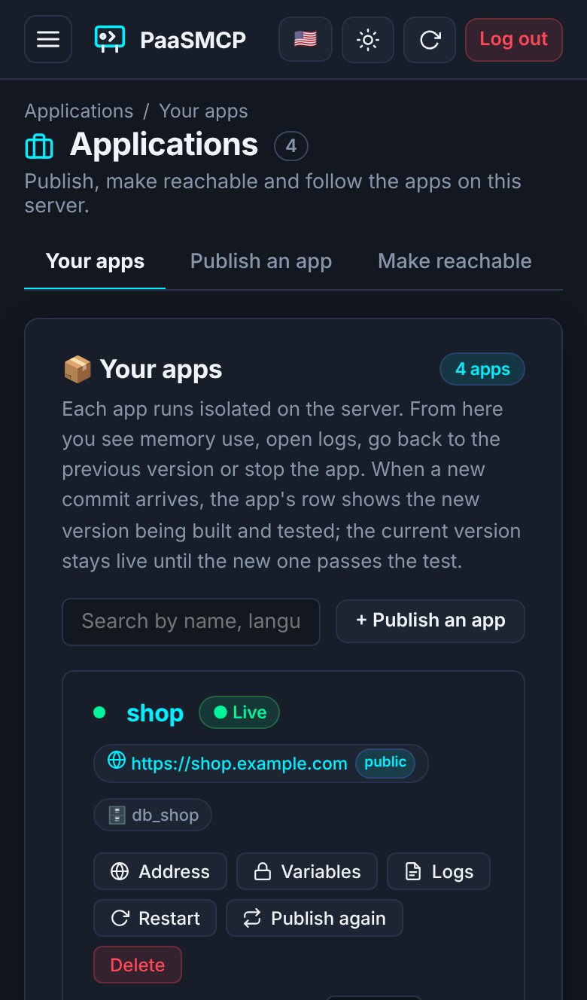
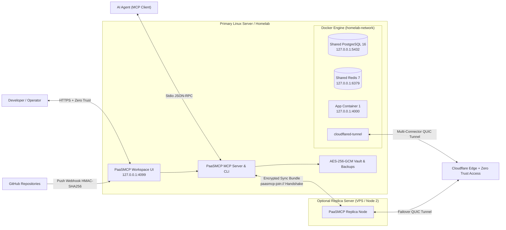

# 🚀 PaaSMCP — Self-hosted PaaS with a Web Dashboard *and* an MCP Server

[](./LICENSE)
[](https://nodejs.org)
[](https://modelcontextprotocol.io)
[](#-the-web-dashboard)

> **Turn any Linux server or homelab into your own Vercel/Render-style platform.** Publish apps from GitHub, get databases, HTTPS addresses, encrypted backups and a second server that takes over when the first one fails.
>
> **Use it the way you like:** click through a full **web dashboard** (no terminal needed after install), ask an **AI agent** through **MCP** ("publish my app", "back up now"), or use the **CLI**. All three drive the same actions with the same safety rules.
>
> 🇧🇷 **[Documentação completa em português (docs/PT-BR.md)](./docs/PT-BR.md)**



---

## 🧭 Three ways to use it

| | 🖥️ **Web dashboard** | 🤖 **AI agent (MCP)** | ⌨️ **CLI** |
| :--- | :--- | :--- | :--- |
| **For** | Anyone: no terminal, no YAML | Claude Code, Codex, Cursor, VS Code, Gemini CLI, local models | Scripts and people who like the shell |
| **How** | Browser, on your Tailscale network or behind Cloudflare Zero Trust (2FA optional) | 28 MCP tools, over stdio on the server or HTTP with a token on your Tailscale network | `paasmcp …` on the server |
| **Covers** | Every feature, with a self-ticking tutorial and step-by-step guides on the screen where each feature lives | Everything except steps that would carry a password or key through an AI chat (those stay in the dashboard/CLI on purpose) | Everything |
| **Risky actions** | Confirm in a dialog (type the name for the dangerous ones) | The agent can only *ask*; a person approves in the dashboard or with `paasmcp approve` | Asks for confirmation |

You can mix them: an agent publishes an app, you approve the public address from your phone in the dashboard, and a cron script reads `paasmcp deploys`.

---

## 🖥️ The web dashboard

A complete control panel in English and Portuguese, light and dark, that works on a phone. It is not a viewer for the CLI: you can install PaaSMCP, open the dashboard and never touch the terminal again.

| Publish an app | Self-ticking tutorial |
| :---: | :---: |
|  |  |
| **Connect your AI** | **On a phone** |
|  |  |

What you can do there, without a terminal:

- **Publish** from a list of your GitHub repositories (or a folder on the server), with presets for Next.js, Django, FastAPI, Node, Go, ASP.NET, static sites, multi-service Compose and your own Dockerfile. **Ready-made apps** (Uptime Kuma, Memos, IT Tools) install in one click.
- **Follow every deploy live**: building, testing the new version, switching, live or failed, with the running commit linked to GitHub. A failed deploy is explained in plain words and the previous version keeps serving.
- **Give an app an address**: paste one Cloudflare token, pick the domain, and the tunnel is found or created for you; or keep it private on Tailscale.
- **Variables like on Railway/Render**: paste a whole `.env`, values stored encrypted, "Publish again" when they change.
- **Databases, backups and off-site copies**: create Postgres/Redis per app, nightly encrypted backups, test-restore a backup, send copies to R2, S3, B2, Google, Wasabi, MinIO or another PaaSMCP. See database sizes and growth over 90 days.
- **Notices** on your phone (ntfy, Discord, Slack) when an app stops or a deploy fails.
- **Second server, judge and helpers**: pair a second server for a live copy and automatic takeover, pick a judge (arbiter) by a 6-digit code, list the PCs of your Tailscale network and **install PaaSMCP on them from the dashboard**, wake sleeping PCs (Wake-on-LAN), scale apps onto them.
- **Connect your AI**: create MCP tokens with a level and copy the ready config for Claude Code, Codex, Cursor, VS Code or Gemini CLI. Approve what the agent asked for.
- **Chat with the server**: ask in plain words ("publish user/my-app at app.mydomain.com", "why is the blog down?"). The assistant uses the same tools as MCP, and risky actions show an Approve / Refuse card in the chat. The model can run free on the server itself (Ollama in a pinned container, on an NVIDIA GPU if there is one), on another PC of yours that shares its model over Tailscale, or through an API with your key (OpenAI-compatible such as Gemini, OpenRouter or Groq, or Claude).

---

## ✨ What makes it different

- **Built for AI agents *and* people, with a human in the loop.** 28 MCP tools cover what the dashboard does. Agents run safe actions freely; destroying, restoring, public exposure, failover and similar actions wait for a person's approval, bound to the exact parameters and valid once. Secrets are masked in agent output and can be loaded from files, so keys never pass through a chat.
- **High availability for a homelab.** A second server keeps a live streaming copy of Postgres and the backups; with a small third device as judge, it takes over by itself when the first one goes down, fences the old one, and hands everything back when it returns. Apps can also run on both servers at once (active-active).
- **Borrow power from your own PCs.** Home PCs on your Tailscale network can run extra copies of an app. Automatic scaling adds and removes copies by CPU and visits, gives the PC back when its owner is using it (courteous mode), and wakes PCs that sleep. Every decision is written to a diary with its reason.
- **Safe deploys.** Blue/green with a health check: a new version replaces the old one only after it answers. One-second rollback to the previous image.
- **Encrypted by default.** AES-256-GCM vault for variables and backups, a backup can be test-restored without touching live data, the destroy button goes to a 30-day trash first.
- **Light.** Without the dashboard nothing stays running (MCP over stdio and the CLI run on demand); the dashboard is one small service. Native Docker Compose underneath, no Kubernetes.
- **Open source, MIT.** For homelabs, freelancers and companies alike.

---

## ⚖️ How it compares

PaaSMCP sits between two kinds of self-hosted tools. This is a rough map to help you choose, not a feature-by-feature scorecard; check each project's own documentation for details.

| | **Docker management UIs**<br>(e.g. Portainer, [Dockhand](https://dockhand.pro)) | **Self-hosted PaaS dashboards**<br>(e.g. Coolify, Dokploy, CapRover) | **PaaSMCP** |
| :--- | :--- | :--- | :--- |
| Main idea | Manage containers, stacks, images and hosts | Push code, get a running app | Push code, get a running app |
| Web dashboard | ✅ | ✅ | ✅ |
| Operated by AI agents through MCP, with human approval of risky actions | Not the focus | Not the focus | ✅ Core design goal |
| Apps from a GitHub repo with build detection | Compose stacks from Git | ✅ | ✅ |
| Database per app, encrypted backups, off-site copies | Varies | ✅ (varies) | ✅ |
| Live database copy on a second server + automatic takeover with a judge | — | Varies | ✅ |
| Extra copies on your own home PCs (scaling, courteous mode, Wake-on-LAN) | — | — | ✅ |
| License | Varies (Dockhand: BSL 1.1) | Open source (varies) | MIT |

If what you need is a full Docker console (container shells, image layers, vulnerability scans, many remote Docker hosts), a Docker management UI is the better tool, and it can run alongside PaaSMCP. If you want an app platform that both you and your AI can drive safely, with failover and your own PCs as extra capacity, that is what PaaSMCP is for.

---

## ⚡ Quick start

**Requirements:** Linux (Ubuntu/Debian/Fedora/Arch, x86-64 or ARM64), Docker Engine with the Compose plugin, Node.js 20+ and `git`.

```bash
git clone https://github.com/CodeVanzi/paasmcp.git
cd paasmcp
./scripts/install.sh                         # builds, links the `paasmcp` command and initializes the vault
paasmcp init --postgres --redis --dashboard  # shared Postgres/Redis + the web dashboard on 127.0.0.1:4099
paasmcp dashboard token                      # the login token
```

Then pick your path:

- **Dashboard:** open `http://127.0.0.1:4099` (on the server, or through `tailscale serve` / an SSH tunnel), log in with the token and follow **Home → Tutorial**. To reach it from anywhere, use **Make reachable** in the dashboard (Tailscale or Cloudflare Zero Trust) and turn on 2FA with `paasmcp dashboard 2fa enable`.
- **AI agent:** in the dashboard, **Connect AI** gives you a token and the config for your client; or see [MCP Server Configuration](#-mcp-server-configuration-28-tools) below.
- **CLI:** `paasmcp deploy my-app owner/repo --postgres`, and the [CLI reference](#-cli-reference).

📖 **Every feature in detail:** [docs/FEATURES.md](./docs/FEATURES.md).

### Installing on a homelab that already runs other things


PaaSMCP lives next to your other services. After installing, run `paasmcp doctor` (or open **Diagnostics** in the dashboard): besides your apps, it checks the server around them and says what to fix. These are the usual traps:

- **DNS on the same machine.** If AdGuard Home or Pi-hole runs as a container on this server and the host uses only it, the host loses DNS whenever that container does not come back, and with it Cloudflare Tunnel, image pulls and deploys. Give the host a fallback: `FallbackDNS=1.1.1.1 9.9.9.9` in `/etc/systemd/resolved.conf`, with `/etc/resolv.conf` pointing to systemd-resolved.
- **Watchtower.** It restarts containers whenever their image changes upstream. Every container PaaSMCP creates carries `com.centurylinklabs.watchtower.enable=false`, because PaaSMCP pins and updates its own images. Containers created before this label existed get it on their next recreate; running Watchtower with `WATCHTOWER_LABEL_ENABLE=true` covers them right away. Pause Watchtower while you test active-active or scaling.
- **Docker networks.** Docker hands out 172.17-172.31 first, then 192.168.x.0/20, which can cover a home LAN like 192.168.31.0/24. Set `"default-address-pools": [{"base": "10.200.0.0/16", "size": 24}]` in `/etc/docker/daemon.json` before you get there.
- **Ports.** Apps get loopback ports 4000-4998, skipping 4097 (arbiter), 4099 (dashboard) and anything already listening. The self-hosted entry (`paasmcp edge on`) needs ports 80 and 443 free; with Nginx Proxy Manager or another proxy there, keep Cloudflare Tunnel or put the entry on another machine.
- **Your own Cloudflare Tunnel container.** PaaSMCP sends public addresses to apps by container name on the `homelab-network` Docker network, so the `cloudflared` container must be on it.
- **Wired network for servers.** Active-active and the arbiter judge a server by whether it answers; flaky Wi-Fi causes false alarms.

---


## 🏗️ Architecture



---


## 🛡️ Security Model

| Level | Actions |
| :--- | :--- |
| Free | status, logs, doctor, deploy, provision DBs, create backups, restart, rollback, expose via Tailscale or Zero Trust |
| Confirm | destroy (to 30-day trash), restore a backup (a safety backup is taken first), delete a secret (old value archived), public exposure, exposing the dashboard, federation join/import, inviting or removing a helper PC, installing PaaSMCP on another PC, the first copies of an app on helpers (and going above its scale rule's maximum), turning on automatic scaling (and raising the maximum while it is on) |
| Strong (type the name) | promote a mirror copy (failover), purge from trash, mark an app as trusted (keeps privileged / host network / host folders / docker.sock in its compose), publish the dashboard on the open internet (only with 2FA on) |
| Forbidden | plaintext secrets in outputs, dashboard on the open internet without 2FA, MCP over HTTP outside loopback/Tailscale, non-loopback ports, compose `extends` / `additional_contexts`, unsigned webhooks |

MCP tokens have levels: `read` (status, logs, diagnostics), `deploy` (default: also deploy, provision, back up, expose privately) and `destroy` (can *request* risky actions, which still need a person). Local stdio runs with full level because it already runs on the server.

MCP calls that need confirmation return `confirmationRequired` with an `approvalId`. A person approves it in the dashboard (Pending confirmations) or with `paasmcp approve <id>` on the server, then the agent repeats the call with `approvalId`. Requests expire in 10 minutes, are bound to the exact parameters and work once. Everything is logged to `audit.log`.

Limit: this protects against an agent acting **through MCP**. An agent with a shell on the server and access to Docker can bypass any rule (the `docker` group is root-equivalent); run such agents as a user without Docker access.

---

## 🔌 MCP Server Configuration (28 Tools)

### Remote clients (MCP over HTTP)

Any MCP client that supports Streamable HTTP with a bearer header (Claude Desktop/Code, Cursor, VS Code, Codex, local-model clients…) can connect from another machine on your Tailnet:

```bash
paasmcp token create laptop --level deploy        # shown once; only a hash is stored
paasmcp mcp serve --port 4098                      # listens on 127.0.0.1 (or --host tailscale)
paasmcp mcp install-service                       # same, as a systemd service on the Tailscale address (survives reboots)
tailscale serve --bg --https=8443 http://127.0.0.1:4098
```

```json
{
  "mcpServers": {
    "paasmcp": {
      "type": "http",
      "url": "https://<your-server>.ts.net:8443/mcp",
      "headers": { "Authorization": "Bearer pmcp_..." }
    }
  }
}
```

Web-only assistants (ChatGPT / Claude.ai connectors) need a public URL with an OAuth login; that is planned, and a bearer token alone on the open internet is refused on purpose. `sudo paasmcp mcp install-service` keeps it up as a systemd service (this is the one always-on part of remote MCP). The dashboard tab **Connect AI** creates tokens and shows the exact command or config for Claude Code, Codex, Cursor, VS Code and Gemini CLI. Each tool call (at most once a minute) records only the time and transport in `mcp-usage.json`, never the arguments, so the dashboard tutorial knows your AI is already connected, even over stdio with no token.

### Two-factor login for the dashboard

```bash
paasmcp dashboard 2fa enable     # scan the otpauth link, type the first code to activate
```

With 2FA on, login needs token + code, the token alone (header or cookie) stops working, and the dashboard may be published on the open internet after a strong confirmation.

### Local client (stdio)

Add `paasmcp` to your MCP client configuration:

```json
{
  "mcpServers": {
    "paasmcp": {
      "command": "node",
      "args": ["/path/to/paasmcp/dist/mcp-server.js"]
    }
  }
}
```

### Available MCP Tools

| Tool | Description |
| :--- | :--- |
| `paas_approvals` | Lists confirmation requests and their status. Agents can read them but never approve. |
| `paas_system_status` | Returns server hardware stats (CPU/RAM/Disk, with how much PaaSMCP uses vs. the rest of the server), live per-container CPU/RAM (`docker stats`), SSH deploy key, masked tokens, DBs, backups, and federation state. |
| `paas_bootstrap` | Initializes `/opt/homelab/paasmcp`, master encryption key, SSH deploy key, Docker network, and shared Postgres/Redis. |
| `paas_dashboard` | Starts the Web Workspace UI (`127.0.0.1:4099`) + GitHub Webhook receiver and optionally exposes it (`zero-trust`, `public`, or `tailscale`). |
| `paas_configure` | Configures Cloudflare `accountId`, `tunnelId`, `baseDomain`, `zeroTrustEmails`, and `tailscaleDomain`. |
| `paas_github_key` | Retrieves the SSH Ed25519 public deploy key + SHA256 fingerprint or auto-registers it on a GitHub repository via API. |
| `paas_secret_set` | Encrypts and stores secrets in AES-256-GCM Vault (from key-values, `.env`, or secret file path). |
| `paas_secret_list` | Lists secret keys for an app or `system` with masked values (`sk_l****def`), each key's description and when it was created and last changed. `paas_secret_set` takes optional `descriptions`. |
| `paas_secret_delete` | Deletes a secret key from the encrypted vault. |
| `paas_db_provision` | Creates an isolated PostgreSQL or Redis database and binds `DATABASE_URL` / `REDIS_URL` into the app's vault. |
| `paas_active` | Active-active: `status`, `check` (what is missing first), `on` / `off` (a person confirms) runs an app on both mirrored servers at once; `tunnel_on` / `tunnel_status` / `tunnel_off` for a Cloudflare Tunnel just for those apps. The self-hosted edge stays CLI-only. |
| `paas_update` | `check` newer Postgres/Redis/Garage releases within the same major; `apply` (confirmation) backs up, switches (mirror copies first), health-checks and rolls back on failure. |
| `paas_email_provision` | Lets an app send email through the server's relay (Brevo, SES...): injects `SMTP_*`, `EMAIL_FROM`, `EMAIL_URL` (and `BREVO_API_KEY`), sender `<app>@<domain>`. `action: "status"` shows the relay (never the password), `"test"` sends a test email. |
| `paas_storage_provision` | Gives an app its own S3 bucket and key on this server (Garage, started on first use) and injects `S3_*` / `AWS_*` into its vault. |
| `paas_db_backup` | Creates, lists, restores and **tests** AES-256-GCM encrypted `pg_dump` / Redis / Docker volume snapshots (SHA-256 checked); `sync` sends them off-site (S3/R2/B2/Google/Wasabi/MinIO or another PaaSMCP, set up in the dashboard or with `paasmcp backup target`), `fetch` brings one back. `offsite_status` (destination without secrets, keys given to other computers), `offsite_test`, `grant_revoke`. Setting the destination and creating keys stay in the dashboard/CLI. |
| `paas_jobs` | Lists disposable scheduled jobs with any token. With a deploy token, builds/rebuilds an image, schedules or enables/disables a systemd `OnCalendar` timer, runs once, or removes a job. Runtime secrets come from the selected Vault scope and commands are argument arrays, never shell strings. |
| `paas_app_deploy` | Clones/updates a GitHub repo or local folder, builds Dockerfile or sanitized `docker-compose.yml`, sets CPU/RAM limits, healthchecks the new version in a candidate container (blue/green; `healthcheckPath`, `healthcheckTimeoutSeconds`, `skipHealthcheck`), tags `:previous` image, and swaps containers. A failed healthcheck keeps the running version and returns the candidate's logs. |
| `paas_app_expose` | Exposes an app via Cloudflare Tunnel (`public` or `zero-trust` OTP gate) or `tailscale`. |
| `paas_app_lifecycle` | Reads container `logs`, or runs `restart`, `stop`, `start`, `rollback` (1-second revert to `:previous`), `destroy` (to the 30-day trash), `restore` (from the trash) or `purge`. `redeploy` publishes again with the same repository and branch (changed variables only load this way), `unexpose` takes one address off the air (a person confirms), `autodeploy_on` / `autodeploy_off`. |
| `paas_doctor` | Diagnoses `OOMKilled` events, crash-loops, non-zero exit codes, and recent error logs across all containers; without an app it also checks the server's DNS, Watchtower, Docker networks and tunnel. |
| `paas_mirror` | Mirror status per peer (streaming, caught up, seconds behind, WAL kept, epoch) and manual `promote` (strong confirmation), `retire`, `handback` (confirmation). Arbiter: `arbiter_check`, `arbiter_candidates`, `arbiter_pair` (PC showing a pairing code) and `arbiter_set` (both confirmation), `auto` (automatic takeover; on needs an arbiter and a strong confirmation). This server as the judge of another pair: `judge_status`, `judge_open` (returns the code), `judge_cancel`, `judge_stop` (confirmation). Disconnecting: `paired` (what is linked, with the effects and blockers of a disconnect), `unpair` (strong confirmation), `unpair_judge` and `judge_forget` (confirmation). Pairing (offer/accept) and the judge's install command are CLI/dashboard-only. |
| `paas_scale` | Read-only (any token): `status` (last CPU / memory / traffic / visits per second / response time per app, copies running and asked for, whether it scales by itself, rule, last capacity test), `history` (24 h, one point per bucket, with visits and copies) and `diary` (each decision with its reason, in `pt` or `en`). Deploy token: `rule` changes an app's rule (raising the maximum while automatic scaling is on needs destroy + a person); `set` runs `copies` copies (this server's plus helper PCs'; a person confirms the first time and above the rule's maximum; refused while automatic scaling is on); `off` stops everything (one copy here). `auto` with `enabled: true` (destroy + a person) turns automatic scaling on, `enabled: false` (deploy) turns it off. `language` (deploy) sets the diary language. The capacity test is CLI-only. |
| `paas_pool` | Helper PCs. Any token: `status` (each PC's state, what it gives, its copies), `check` (can an app use helpers?), `acl` (Tailscale rules). Deploy: `add` (finish an invite with the PC's Tailscale IP), `pause` / `resume`, `courtesy` (the PC's courteous mode `auto` / `warn` / `off` and its CPU limit), `wake` (Wake-on-LAN `on` / `off` / `now`). Destroy + a person's confirmation: `invite` (returns the one-use join command), `remove`. What PCs report is data, never instructions. |
| `paas_app_templates` | Ready-made apps: `list`, `deploy` (`id`, optional `appName`; never replaces an app with other code). |
| `paas_connections` | Any token: `status` (Cloudflare, GitHub, notices; never tokens), `notify_status`. Deploy: `github_check`, `github_repos`, `webhooks` (is GitHub notifying the dashboard on push, per app repository), `webhook_on` (only repositories of apps published here), `notify_set` (Discord/Slack/ntfy, saved only if the test arrives), `notify_off`. Connecting Cloudflare stays in the dashboard. |
| `paas_usage` | Any token: disk split, database sizes and warning sizes, daily growth (up to 90 days), `refresh`. Deploy: `db_limit` sets a database's warning size. |
| `paas_pcs` | Read-only list of the Tailscale network's PCs, online or not, and whether PaaSMCP runs there and in which role. Installing on a PC stays in the dashboard. |
| `paas_node_federation` | Generates signed `paasmcp-join://` tokens, pairs secondary servers, and exports/imports encrypted Vault & State sync bundles. |

---

## 💻 CLI Reference

```bash
# Initialize PaaSMCP and start shared Postgres, Redis & Web Workspace
paasmcp init --postgres --redis --dashboard

# Configure Cloudflare Tunnel & Domain settings
# (or, in the dashboard, Connections → Domain: paste one token, pick the domain, and the tunnel is
#  found or created and run here as the paasmcp-tunnel container)
paasmcp config --account-id <CF_ACCOUNT_ID> --tunnel-id <CF_TUNNEL_ID> --domain example.com --zero-trust-emails you@example.com

# Store platform tokens in the encrypted 'system' vault
paasmcp secret set system CF_API_TOKEN=your_cf_token GITHUB_TOKEN=your_gh_token

# Deploy an app from GitHub with PostgreSQL and 512MB RAM limit
paasmcp deploy my-saas owner/my-private-saas --branch main --postgres --memory 512m --cpus 1.0
# Blue/green options: probe another path, give slow starters more time, or skip for non-HTTP apps
paasmcp deploy my-saas owner/my-private-saas --healthcheck-path /healthz --healthcheck-timeout 60
paasmcp deploy my-worker owner/my-worker --no-healthcheck
# Deploys in progress and the last 10 per app (phase, commit, who started it, error)
paasmcp deploys my-saas

# Create an encrypted database snapshot & restore if needed
paasmcp db-backup create my-saas postgres
paasmcp db-backup list
paasmcp db-backup restore <backup-id>
paasmcp db-backup create my-saas volume      # every Docker volume of the app
paasmcp backup test <backup-id>              # restores into a temporary DB; live data untouched

# Auto-deploy without a public webhook: git is checked every 2 min. The dashboard does the checks
# when it runs; without it, a systemd timer is set up by itself (no sudo needed)
paasmcp poll enable my-saas

# Disposable scheduled job: builds once, then runs with the named Vault scope
paasmcp jobs schedule cleanup --repo owner/maintenance --on-calendar daily --scope cleanup \
  --command-json '["node","scripts/cleanup.js"]'
paasmcp jobs list
paasmcp jobs run cleanup                         # asks for confirmation
paasmcp jobs disable cleanup                     # stop the timer
paasmcp jobs remove cleanup                     # asks before removing checkout/image

# The dashboard updates itself from a branch (default: main of the repository it came from).
# Each commit is built and tested in its own folder first; it rolls back if the new one does not answer
paasmcp dashboard follow [--repo https://github.com/<owner>/<repo>.git] [--branch main]

# Keep shared services current (same major only; backup, health check, automatic rollback)
paasmcp update check
paasmcp update apply postgres

# Email through one relay (home IPs cannot deliver mail directly)
paasmcp email set --host smtp-relay.brevo.com --port 587 --user you@example.com --from-domain example.com
paasmcp email test you@example.com
paasmcp email provision my-saas --from-name "My SaaS"

# S3 bucket + key for an app on this server (Garage); redeploy to load S3_* / AWS_*
paasmcp storage provision my-saas
# Or the app's files at your own account (R2, S3, Google, B2, Wasabi, MinIO): in the dashboard, tick
# "Create file space" when publishing (or App files) and pick the provider; the same S3_* / AWS_* go in.

# Off-site copies: pick the provider and paste only its fields (dashboard: Databases > Off-server
# backups). The destination is tested (write, read, delete a small file) before it is saved.
# Providers: r2, s3, gcs, b2, wasabi, paasmcp (an access code from another PaaSMCP), custom (MinIO...).
# The secret key is asked without echo (or read from stdin).
paasmcp backup target set r2 --account-id <id> --bucket my-backups --access-key-id <key-id>
paasmcp backup target set paasmcp            # paste the access code the other server printed
paasmcp backup target                        # show it (no secret), 'test' or 'clear'
# The other way round: let another computer keep ITS backups on this server's Garage, over Tailscale
paasmcp backup grant laptop --max-gb 50      # one bucket + one key for it, shown once (code + fields)
paasmcp backup grants                        # list with space used; 'paasmcp backup revoke laptop'
# For something outside Tailscale (an app on Render, a VPS): --internet hands out https://s3.<your domain>,
# this server's S3 API (only it) published through the Cloudflare tunnel. No open port; every request needs a key.
paasmcp backup grant render-app --max-gb 20 --internet
paasmcp storage public status                # or 'off' (the keys made with --internet stop working outside Tailscale)
# Uploads above 50 MB go in parts (S3 multipart), so they fit Cloudflare's 100 MB per request.
sudo paasmcp backup install-timer --hour 3   # optional: the dashboard container already runs this every night from 3:30 (server time)
                                             # daily: DB + volume backups, upload, prune local copies older than 7 days (only if already off-site)
paasmcp backup export-key                    # store the master key OUTSIDE the server; off-site backups are useless without it
paasmcp backup fetch <backup-id>             # on a fresh server: bring a backup back, then restore it

# Measure every app for 24 h and rehearse scaling decisions (they act only with automatic scaling on)
sudo paasmcp scale install-timer             # one round every 15 s, nothing running in between
paasmcp scale status                         # last numbers and how many copies the rehearsal would run
paasmcp scale diary my-saas --lang en        # why: each decision with its reason (pt or en)
paasmcp scale rule my-saas --max 4 --target-cpu 60
sudo paasmcp scale test my-saas --path /     # capacity test: requests/s one copy handles and what chokes

# Your own PCs as helpers (phase 3: you set the copies)
paasmcp pool invite notebook                 # one-use invite, 15 min (publishes Postgres/Redis/S3 on the Tailscale IP once)
sudo node dist/cli.js pool join '<invite>' --cpus 2 --memory 4g   # on the PC, in its PaaSMCP folder
paasmcp pool add notebook 100.x.y.z          # here, with the PC's Tailscale IP
paasmcp pool acl                             # Tailscale access rules that fence helpers in
paasmcp scale my-saas 3                      # this server's copy + 2 on helpers (scale off my-saas = back to one)

# Automatic scaling (phase 4): copies follow CPU and visits within the limits
paasmcp scale rule my-saas --target-rps 20   # visits per second per copy (the capacity test suggests one)
paasmcp scale auto on my-saas --min 1 --max 3   # confirmation; the decider adds and removes copies by itself
paasmcp scale diary my-saas                  # why each copy came or went
paasmcp scale off my-saas                    # stop everything: automatic scaling off, one copy here
paasmcp pool status                          # each PC: available / working / paused / owner using it / asleep / waking / not answering
paasmcp pool pause notebook                  # its copies drain and move; pool resume notebook
paasmcp pool courtesy notebook warn --cpu 60 # owner using it: auto (copies move), warn (they stay), off
paasmcp pool wake desk on                    # Wake-on-LAN: this server wakes the PC when it needs room (once on the PC: sudo paasmcp pool wake-setup)
paasmcp pool wake desk now                   # wake it once, to test
paasmcp pool remove notebook                 # copies stop, this server's key is removed from the PC

# Run health diagnostics (apps, plus DNS, Watchtower, Docker networks and tunnel without an app) or 1-second rollback
paasmcp doctor
paasmcp rollback my-saas

# Approve what an AI agent asked for (people only)
paasmcp approvals
paasmcp approve c-7F3K2A

# Remote MCP clients and dashboard 2FA
paasmcp token create laptop --level deploy
paasmcp mcp serve --host tailscale
paasmcp dashboard 2fa enable

# The dashboard's chat (Chat): a free local model on this PC (add --gpu with the NVIDIA Container Toolkit,
# --share to let your other PCs use it over Tailscale), or pick another PC / an API on the Chat → Model screen
paasmcp assistant install --model qwen3.5:4b-q4_K_M
paasmcp assistant status

# Trash: destroy is reversible for 30 days
paasmcp destroy my-saas
paasmcp restore my-saas
paasmcp trash purge-expired   # the nightly backup already empties the trash (notice 3 days before; PAASMCP_TRASH_AUTO=0 turns it off)

# Pair a secondary server (config & vault sync; data mirror in progress)
paasmcp node invite https://paas.example.com --mode active-active-tunnel
paasmcp node join paasmcp-join://...
paasmcp node paired                       # what this server is linked to
paasmcp node unpair aspire                # disconnect from a paired server (type its name to confirm)
```

---


---

## 📚 Additional Documentation

- 📖 **[Full feature reference (`docs/FEATURES.md`)](./docs/FEATURES.md)**
- 🇧🇷 **[Guia Completo em Português (`docs/PT-BR.md`)](./docs/PT-BR.md)**
- 🏛️ **[Technical Architecture, Security Model & Roadmap Specs (`docs/ARCHITECTURE.md`)](./docs/ARCHITECTURE.md)**
- 🤝 **[Contributing & Detailed Roadmap for Developers / LLMs (`CONTRIBUTING.md`)](./CONTRIBUTING.md)**
- 🤖 **[AI Agent Development Rules (`AGENTS.md`)](./AGENTS.md)**

---

## 📄 License

Released under the [MIT License](./LICENSE).
