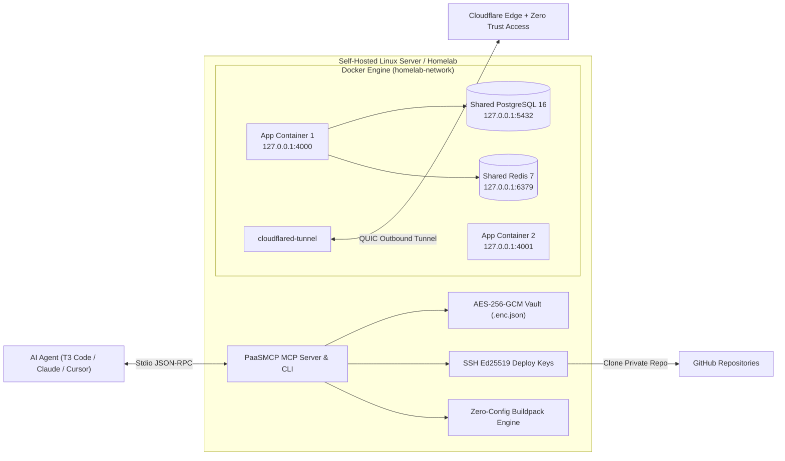

# 🚀 PaaSMCP — Agent-First Micro-PaaS & MCP Server

[](./LICENSE)
[](https://nodejs.org)
[](https://modelcontextprotocol.io)

> **Turn any Linux server or Homelab into a Render / Railway experience operated directly by AI Agents via MCP (Model Context Protocol) or CLI — with zero idle RAM overhead.**  
> 🇧🇷 **[Leia a Documentação Completa em Português aqui (docs/PT-BR.md)](./docs/PT-BR.md)**

---

## 💡 Why PaaSMCP?

Self-hosted PaaS dashboards like Coolify, Dokploy, and CapRover are great for manual clicking, but they:
1. Consume **300MB–1GB+ of RAM** continuously just to run their web control planes and internal databases.
2. Require manual multi-step setup for SSH deploy keys, database bindings, and Cloudflare Tunnel / Zero Trust rules.
3. Were **not designed from day one to be operated by AI Agents via MCP**.

**PaaSMCP** takes a radically lightweight, **Agent-First** approach:
- **0 MB Idle Daemon Overhead:** Runs on-demand via MCP stdio or CLI, orchestrating native Docker Compose stacks directly on your host.
- **AES-256-GCM Encrypted Secrets Vault:** Secrets are encrypted at rest (`/opt/homelab/paasmcp/vault/<app>.enc.json`) with a `0600` master key. Values are masked in MCP outputs (`sk_l****def`) and can be ingested directly from files so sensitive keys never pass through LLM chat histories.
- **Instant Multi-Tenant Databases:** Provision isolated PostgreSQL 16 databases (`db_<app>` + `user_<app>`) or Redis 7 logical instances in 1 second, automatically injecting `DATABASE_URL` and `REDIS_URL` into the app's encrypted vault.
- **Zero-Config Buildpacks:** Automatically builds repositories with a custom `Dockerfile` or generates optimized multi-stage Dockerfiles for **Node.js, Next.js, Vite/React/Astro SPAs, Python (FastAPI/Flask/Django), Go, and Static HTML**.
- **Built-in Web Control Plane (`paasmcp-dashboard`):** Optional ultra-lightweight dark-mode web dashboard (protected by `DASHBOARD_TOKEN` + Cloudflare Zero Trust Access) that can be hosted on its own subdomain (`paas.example.com`) to visually deploy apps, inspect logs, manage encrypted Vault secrets, and provision databases.
- **1-Call Secure Internet Exposure:** Automatically updates **Cloudflare Tunnel (`cloudflared`)** ingress rules, creates proxied CNAME DNS records, attaches **Cloudflare Zero Trust Access (Email OTP)** policies, or exposes privately on your **Tailscale Tailnet (`Tailscale Serve`)**.

---

## 🏗️ Architecture



---

## ⚡ Quick Installation

### Requirements
- Linux (Ubuntu/Debian/Fedora/Arch)
- Docker Engine & Docker Compose plugin (`docker compose`)
- Node.js `>= 20.0.0` & `git`

### 1-Command Setup
```bash
git clone <repository-url>
cd paasmcp
./scripts/install.sh
```

---

## 🔌 MCP Server Configuration

Add `paasmcp` to your MCP client configuration (`claude_desktop_config.json`, Cursor, T3 Code, Windsurf, etc.):

```json
{
  "mcpServers": {
    "paasmcp": {
      "command": "node",
      "args": ["/path/to/paasmcp/dist/mcp-server.js"]
    }
  }
}
```

### Available MCP Tools (12 Tools)

| Tool | Description |
| :--- | :--- |
| `paas_system_status` | Returns server hardware stats (CPU/RAM/Disk), SSH public deploy key, masked system tokens, databases, and apps. |
| `paas_bootstrap` | Initializes `/opt/homelab/paasmcp`, master encryption key, SSH deploy key, Docker network, and shared Postgres/Redis. |
| `paas_dashboard` | Starts the built-in Web Control Plane Dashboard (`127.0.0.1:4099`) and optionally exposes it on a subdomain (`zero-trust`, `public`, or `tailscale`). |
| `paas_configure` | Configures Cloudflare `accountId`, `tunnelId`, `baseDomain`, `zeroTrustEmails`, and `tailscaleDomain`. |
| `paas_github_key` | Retrieves the SSH Ed25519 public deploy key or auto-registers it on a GitHub repository via API. |
| `paas_secret_set` | Encrypts and stores secrets in AES-256-GCM Vault (from key-values, `.env`, or secret file path). |
| `paas_secret_list` | Lists secret keys for an app or `system` with masked values (`sk_l****def`). |
| `paas_secret_delete` | Deletes a secret key from the encrypted vault. |
| `paas_db_provision` | Creates an isolated PostgreSQL or Redis database and binds `DATABASE_URL` / `REDIS_URL` into the app's vault. |
| `paas_app_deploy` | Clones/updates a GitHub repo or local folder, builds image, injects secrets + DB, starts container, and syncs Homepage. |
| `paas_app_expose` | Exposes an app via Cloudflare Tunnel (`public` or `zero-trust` OTP gate) or `tailscale`. |
| `paas_app_lifecycle` | Reads container `logs`, or runs `restart`, `stop`, `start`, or `destroy`. |

---

## 💻 CLI Reference

```bash
# Initialize PaaSMCP and start shared Postgres & Redis clusters
paasmcp init --postgres --redis

# Configure Cloudflare Tunnel & Domain settings
paasmcp config --account-id <CF_ACCOUNT_ID> --tunnel-id <CF_TUNNEL_ID> --domain example.com --zero-trust-emails you@example.com

# Store platform tokens in the encrypted 'system' vault
paasmcp secret set system CF_API_TOKEN=your_cf_token GITHUB_TOKEN=your_gh_token

# Register SSH Deploy Key on a private GitHub repository
paasmcp github-key owner/my-private-saas

# Deploy an app from GitHub with automatic PostgreSQL provisioning
paasmcp deploy my-saas owner/my-private-saas --branch main --postgres

# Expose on https://my-saas.example.com (public or zero-trust)
paasmcp expose my-saas public my-saas

# View logs or manage container lifecycle
paasmcp logs my-saas
paasmcp restart my-saas
```

---

## 📚 Additional Documentation

- 🇧🇷 **[Guia Completo em Português (`docs/PT-BR.md`)](./docs/PT-BR.md)**
- 🏛️ **[Technical Architecture & Security Model (`docs/ARCHITECTURE.md`)](./docs/ARCHITECTURE.md)**
- 🤝 **[Contributing & Roadmap (`CONTRIBUTING.md`)](./CONTRIBUTING.md)**

---

## 📄 License

Released under the [MIT License](./LICENSE).
